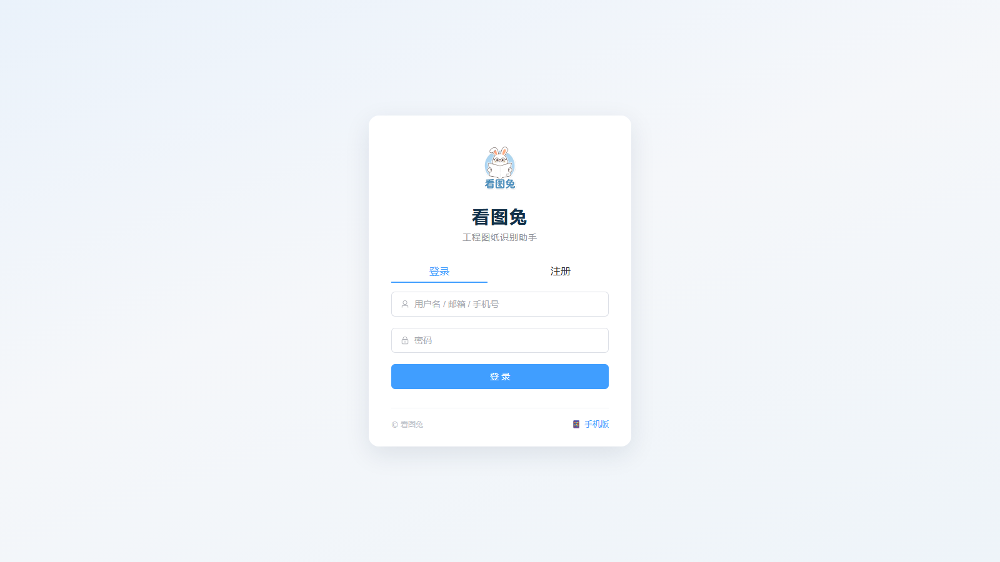
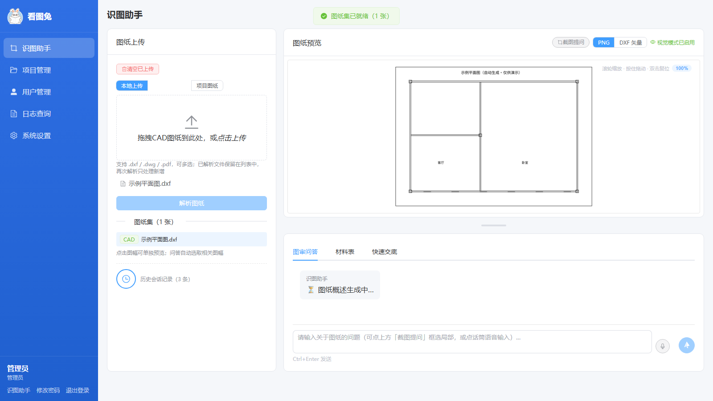
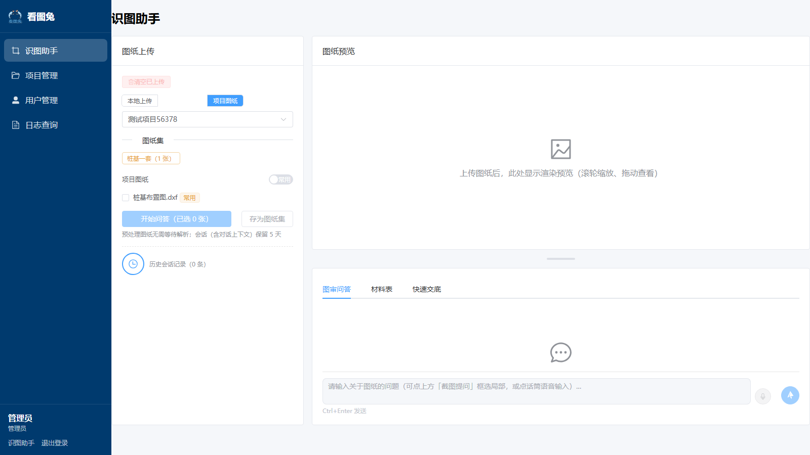
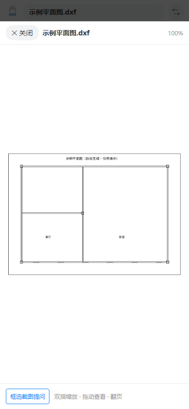

# 看图兔

🐰 独立的**工程图纸识别助手**网站 —— 上传 DXF / DWG / PDF 工程图纸，AI 自动解析图层、实体和文字标注，支持针对图纸内容的视觉问答、材料表提取、快速交底。PC 桌面端 + 移动 H5 双前端，共享同一后端。



## 功能特性

- **多格式图纸上传**：DXF 直传、DWG（内置 LibreDWG 转 DXF）、PDF（矢量直渲 + 文字层提取），多文件组成图纸集
- **视觉问答**：图纸文本摘要 + 渲染图双通道送多模态大模型，支持框选局部截图提问、语音输入
- **项目图纸管理**：按项目归集图纸，zip 批量上传 + 后台串行预处理队列（重启自动恢复）；常用图纸置顶；图纸集跨会话复用
- **图纸脱敏**：参与建设/施工/设计/监理等单位名称自动打码后再送模型，回答中还原，保护项目信息
- **5 天会话**：项目问答上下文保留 5 天，可回看历史会话
- **材料表提取 / 快速交底**：一键生成材料清单与交底文档
- **识图精度优化**：文字标注去重注入、图框内容判定、OCR 补文字层（扫描件）、密集小字分块渲染、DXF 块展开
- **用户体系**：注册（审批制）+ 登录（JWT，自动续期）+ 修改密码；超管管理用户、看审计/LLM 调用/错误日志与用量统计
- **双前端**：PC（Element Plus）+ 移动 H5（Vant，触摸缩放/拖动），数据互通

| PC 识图助手 | 项目图纸管理 | 移动 H5 |
|---|---|---|
|  |  |  |

## 技术栈

| 层 | 技术 |
|---|---|
| 后端 | FastAPI · SQLAlchemy · SQLite（本地）/ PostgreSQL（生产） |
| 图纸解析 | ezdxf（DXF）· LibreDWG（DWG→DXF）· PyMuPDF（PDF）· RapidOCR（OCR 补文字层）· matplotlib（渲染） |
| LLM | OpenAI / Anthropic SDK 兼容的多 Provider 体系，多模态视觉模型（DeepSeek-V4.1-Flash 等） |
| PC 前端 | Vue 3 · Element Plus · Pinia · Vite |
| 移动前端 | Vue 3 · Vant · Vite |
| 部署 | Docker Compose（app + nginx + postgres） |

## 目录结构

```
├── backend/            # FastAPI 后端
│   ├── main.py         # 入口
│   ├── auth/           # 认证：注册/登录/JWT/用户管理
│   ├── api/            # 识图 / 项目 / 审计 API
│   ├── services/       # drawing_service / mask_service（脱敏）/ llm_service / 预处理 worker
│   └── db/             # SQLAlchemy（DATABASE_URL 留空则 SQLite 兜底）
├── frontend-pc/        # PC 前端（Element Plus）
├── frontend-mobile/    # 移动 H5（Vant），挂载 /m
├── assets/             # CJK 字体 + LibreDWG 二进制（linux/win）
├── deploy/             # 部署脚本
├── Dockerfile / docker-compose.yml / nginx.conf
└── data/               # 运行时数据（gitignore：含 LLM key 的 app_config.json）
```

## 快速开始（本地开发）

```bash
# 1. 后端（Python 3.12+；Windows 脚本设 PYTHONIOENCODING=utf-8）
cd backend
pip install -r requirements.txt
python -m uvicorn main:app --host 127.0.0.1 --port 7780

# 2. PC 前端（5173）
cd frontend-pc && npm install && npm run dev

# 3. 移动前端（5174，proxy 到 7780）
cd frontend-mobile && npm install && npm run dev
```

启动后访问 `http://127.0.0.1:7780/`（PC）/ `http://127.0.0.1:7780/m/`（移动）。
默认超管 `admin / admin123`，**首次登录后请立即修改密码**（侧栏底部「修改密码」）。

## 配置

- **LLM Provider**：登录超管后于系统设置页配置（多模态视觉模型的 key 与模型名），配置存于 `data/app_config.json`
- **环境变量**：见 `.env.example`（`DATABASE_URL` 留空则 SQLite 兜底；生产用 PostgreSQL）

## 生产部署（Docker Compose）

```bash
cp .env.example .env   # 填写 IMAGE_TAG / POSTGRES_*
docker compose -p xiaotutu build
docker compose -p xiaotutu up -d
# nginx 对外 80；健康检查 /api/health
```

国内服务器建议先配 Docker registry mirror；LibreDWG 二进制与字体已随仓库提供，镜像构建时自动 COPY。

## 安全设计

- 图纸中的建设/施工/设计/监理等单位名称在送 LLM 前自动脱敏，回答阶段还原（见 `backend/services/mask_service.py`，含真实图纸误报回归测试）
- 密码 bcrypt 哈希；JWT access 120min + refresh 3 天，前端 401 自动续期
- 下载/预览一律走鉴权接口，不裸开 URL
- `data/`、`.env`、`*.pem` 均已 gitignore

## 文档

- [部署指南](docs/部署指南.md) —— Docker Compose / 本地开发 / 域名 HTTPS / 备份升级
- [使用说明](docs/使用说明.md) —— 角色权限、上传问答全流程、脱敏、图纸集
- [常见问题](docs/常见问题.md) —— 部署故障、图纸处理失败、401/413、语音输入等 17 条排障

## 许可

MIT License（见 LICENSE）。仓库捆绑的 LibreDWG 二进制为 [GPL 许可](https://www.gnu.org/licenses/gpl.html)的独立组件（说明见 `assets/bin/libredwg/README.txt`），其版权归属 GNU LibreDWG 项目。
